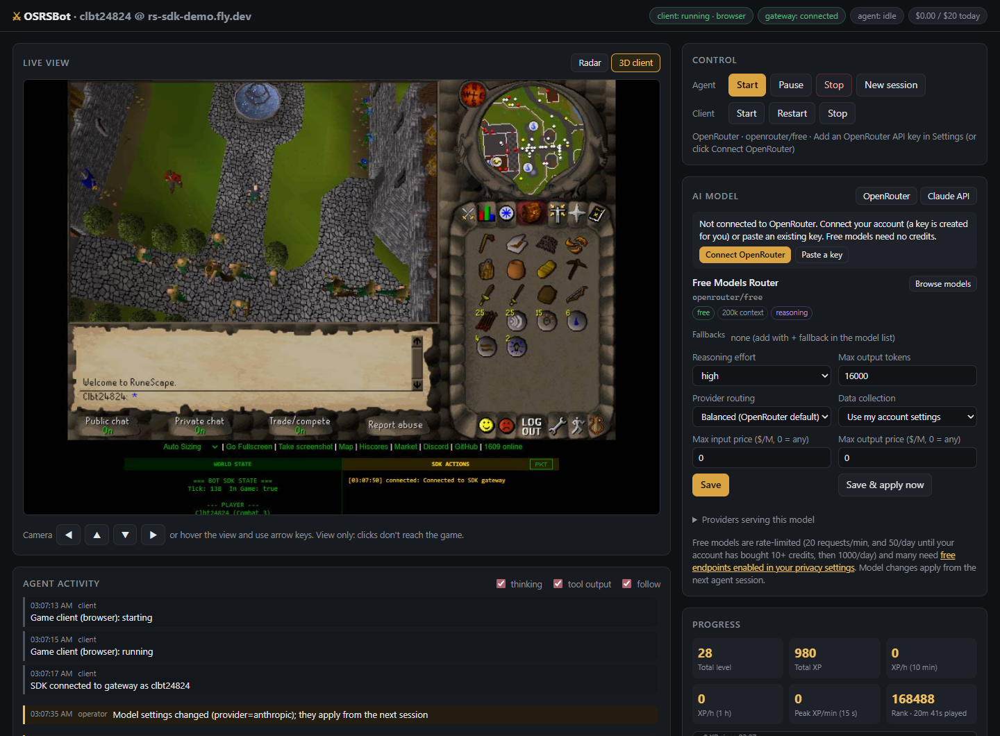
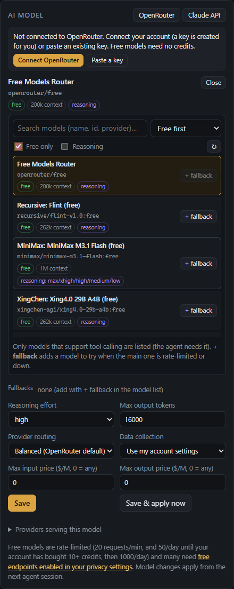
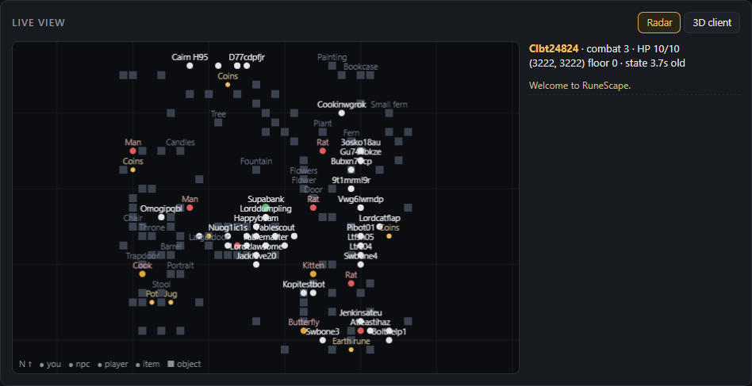
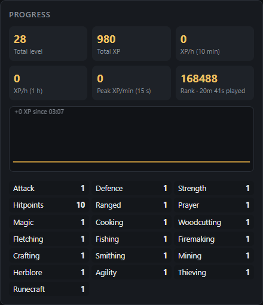
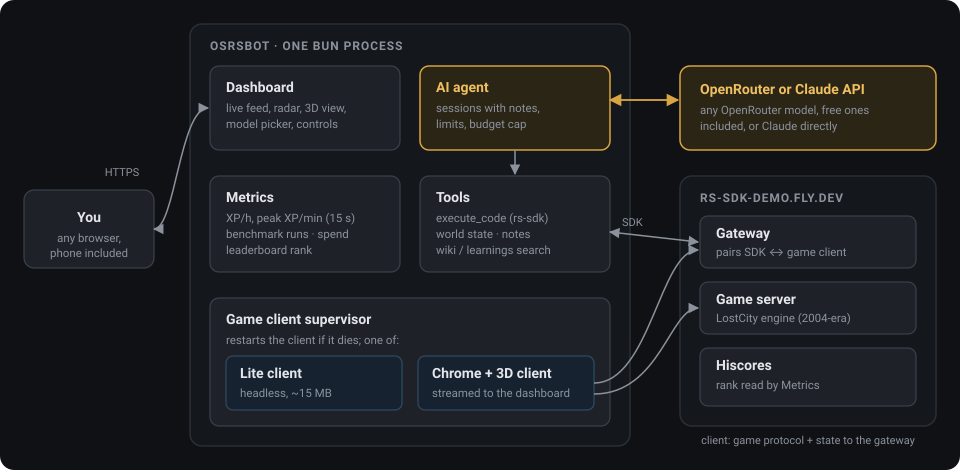

# OSRSBot

**An AI agent that plays [rs-sdk](https://github.com/MaxBittker/rs-sdk), the research server for RuneScape-style bots, on any model from [OpenRouter](https://openrouter.ai) (free ones included) or the Claude API.** Give it a goal and it plays on its own for hours: it writes TypeScript against the game, runs it, checks what happened and adjusts. It runs on a small server, you watch and steer it from a browser dashboard (including a live 3D view of what the bot sees), and it scores itself against the demo server's leaderboard so you can benchmark models.



> [!WARNING]
> **One bot per person on the shared demo server.** `rs-sdk-demo.fly.dev` is a free community server with no uptime or persistence guarantee, and every bot on it shares the same capacity. Don't run fleets or many parallel benchmark bots against it. For heavy benchmarking, [run your own rs-sdk server](https://github.com/MaxBittker/rs-sdk#running-the-server-locally) and set Server to `localhost` in Settings.

## What it does

**Plays by writing code.** The agent works through rs-sdk's `execute_code`: it writes a TypeScript snippet against the `bot` and `sdk` APIs, runs it on the character, reads the result and the world state, and iterates, starting with 10-second experiments and growing them into grinding loops once they work. It can search rs-sdk's tested snippets, its game wiki (item, NPC and shop locations) and the API docs, and keeps its own notes between sessions.

**Runs on any model, free ones included.** Out of the box it uses OpenRouter's free model router, so it costs nothing to try. The dashboard's **AI model** card makes switching easy:



- **Connect OpenRouter** in one click (it creates a key for you), or paste a key.
- See what you've spent today and this month, your key's spending limit, and today's free-model quota (50 requests a day until your account has bought 10+ credits, then 1000).
- **Browse every tool-capable model** on OpenRouter: search, filter to free or reasoning models, sort by price, context size or age, and see each one's price, context window and supported reasoning levels. Models your privacy settings block are marked.
- **Fallback models** take over when the main one is rate-limited or down.
- **Reasoning effort** offers only the levels the chosen model supports.
- **Routing:** prefer the cheapest, fastest or lowest-latency provider, or the best tool-calling ones (`:exacto`); cap prices per million tokens; deny providers that log or train on prompts.
- See which providers serve the selected model, with their prices, uptime, latency and speed.
- Or switch to the **Claude API** directly (adaptive thinking, prompt caching, compaction, refusal fallbacks).

**Runs for days without running up a bill.** The agent works in sessions: each one starts fresh from the goal, its notes and the current game state, so context stays bounded. The exact cost OpenRouter reports for every request counts against a daily budget that pauses the agent when it's spent. The large system prompt (rs-sdk's guide and API reference) is prompt-cached where the model supports it, and models with small context windows get a slimmer prompt and trimmed old tool output. Rate limits, an exhausted free quota (waits until midnight UTC), missing credits and privacy-setting blocks are each handled with a clear message instead of a crash loop.<br clear="right">

**Shows you what it's doing.** The dashboard streams the agent's reasoning, every snippet it runs and the results, alongside the bot's surroundings, stats, skills and inventory. Send it a message mid-run, change its goal, interrupt a loop, or pause it.

<table>
  <tr>
    <td width="62%"></td>
    <td width="38%"></td>
  </tr>
  <tr>
    <td><b>Radar.</b> A top-down map of everything near the bot: players, NPCs, ground items and objects. Works with the lightweight client.</td>
    <td><b>Progress.</b> Total level and XP, XP/hour, peak XP/min and the bot's rank and playtime on the leaderboard.</td>
  </tr>
</table>

**Lets you see what the bot sees.** In **Browser** client mode the bot plays through rs-sdk's real 3D web client in headless Chrome, and the dashboard streams it live (top screenshot). Arrow keys turn the camera; clicks never reach the game, so you can't fight the agent for control. The default **Lite** client is rs-sdk's headless one: around 15 MB, no rendering, radar only. Either way it's restarted if it dies.

**Benchmarks models.** Timed benchmark runs record XP gained, levels, average XP/hour, API cost and [rs-bench](https://github.com/MaxBittker/rs-bench)'s headline metric, peak XP/min over any 15-second window. Run the same goal on different models or effort levels and compare them side by side. The bot's standing on the [demo server hiscores](https://rs-sdk-demo.fly.dev/hiscores) (total level, ties broken by lowest playtime) is tracked too.

## How it works



rs-sdk's SDK can't reach the game server directly: a logged-in game client has to be attached to rs-sdk's gateway, which pairs it with the SDK. OSRSBot runs that client itself (lite or browser), holds the SDK's control connection, and gives the model tools on top of it. `execute_code` is rs-sdk's own implementation, so any snippet from rs-sdk's [`learnings/`](https://github.com/MaxBittker/rs-sdk/tree/main/learnings) works unchanged.

## Quick start

Needs [Bun](https://bun.sh) 1.3+, git, and an [OpenRouter account](https://openrouter.ai) (free) or a [Claude API key](https://console.anthropic.com/).

```bash
git clone https://github.com/CornThatLefty/OSRSBot.git && cd OSRSBot
bun install
bun run setup          # clones rs-sdk into vendor/ and installs its dependencies
cp .env.example .env   # optional: OPENROUTER_API_KEY or ANTHROPIC_API_KEY; DASHBOARD_PASSWORD on a server
bun start
```

Open http://localhost:8080, then:

1. **AI model** → **Connect OpenRouter** (or paste a key). The default model, `openrouter/free`, costs nothing. If free models fail with a privacy error, enable the free-endpoint options in your [OpenRouter privacy settings](https://openrouter.ai/settings/privacy).
2. **Settings** → pick a bot name (1-12 letters/digits). The server creates the account on first login. The generated password is saved in `data/credentials.json`; **back up `data/`** or you lose the account.
3. **Control → Client → Start.** Wait for the client pill to turn green (logged in). The browser client takes up to a minute.
4. Set a **goal** and press **Agent → Start**.

Free models are a fine way to try it, but how far the bot gets depends a lot on the model: strong tool-calling models get much further. Compare them with benchmark runs.

The bot starts on the tutorial island; the agent knows to skip it.

## Running it on a server

**Anyone who can log in to the dashboard can make the agent run code on the server.** Always set `DASHBOARD_PASSWORD` before the dashboard is reachable from anywhere but the server itself, and put HTTPS in front of it (Caddy, Cloudflare Tunnel) if it faces the internet. Without a password it only listens on 127.0.0.1; reach it with an SSH tunnel:

```bash
ssh -L 8080:localhost:8080 you@your-server
```

Sizing: lite mode runs comfortably on 1 core / 1 GB RAM. Browser (3D) mode wants 2 cores / 2 GB.

### Proxmox LXC (Arch Linux), recommended

Run it directly in the container with systemd. Docker inside an LXC needs nesting and keyctl enabled and breaks in odd ways in unprivileged containers, so skip it there. An unprivileged container is fine: Chromium already runs with `--no-sandbox`.

Take a Proxmox snapshot of the container before the first `pacman -Syu` (and before later upgrades), so a bad update is one rollback away. Then, as root in the container:

```bash
# A fresh Arch template needs its keyring initialised once
pacman-key --init && pacman-key --populate archlinux
pacman -Syu git bun chromium

git clone https://github.com/CornThatLefty/OSRSBot.git /opt/osrsbot
cd /opt/osrsbot
PUPPETEER_SKIP_DOWNLOAD=true bun install   # use Arch's chromium instead of puppeteer's download
bun run setup                              # clones rs-sdk into vendor/

cp .env.example .env && nano .env
#   OPENROUTER_API_KEY=...   (or skip it and use Connect OpenRouter in the dashboard)
#   DASHBOARD_PASSWORD=...
#   CHROME_PATH=/usr/bin/chromium

useradd --system --no-create-home --home-dir /opt/osrsbot osrsbot
chown -R osrsbot:osrsbot /opt/osrsbot && chmod 600 .env
cp deploy/osrsbot.service /etc/systemd/system/
systemctl daemon-reload && systemctl enable --now osrsbot
journalctl -u osrsbot -f
```

The unit runs `/usr/bin/bun`, where Arch's package installs it. If you installed Bun another way, check `which bun` and edit `ExecStart`.

Notes:
- `.env` is created fresh on the server and never committed. To move an existing bot over, copy its `data/` folder (it holds the account password) with `scp -r data/ root@<container>:/opt/osrsbot/` before the first start, then `chown -R osrsbot:osrsbot /opt/osrsbot/data`.
- **Back up `/opt/osrsbot/data`.** Losing `data/credentials.json` loses the game account.
- If browser mode keeps crashing, check `df -h /dev/shm`: Chromium needs more than a few MB of shared memory there.
- To update: `git pull`, `bun install`, `bun run setup --update`, then `systemctl restart osrsbot`.

### Docker (other hosts)

On a VM or bare-metal host, Docker is the shortest route (Chromium is included in the image):

```bash
git clone https://github.com/CornThatLefty/OSRSBot.git osrsbot && cd osrsbot
cp .env.example .env && nano .env      # DASHBOARD_PASSWORD, and OPENROUTER_API_KEY or ANTHROPIC_API_KEY
docker compose up -d --build
```

The compose file publishes the dashboard on the host's loopback only (use the SSH tunnel above or a reverse proxy) and keeps `data/` in `./data`.

### Other Linux without Docker

Same as the Arch steps, with your distro's packages (on Debian/Ubuntu, `apt install chromium` and install Bun from https://bun.sh), and `ExecStart` pointed at `which bun`.

## Using it

| Control | What it does |
|---|---|
| Agent Start / Pause / Stop | Pause waits for the current step; Stop cancels running code. |
| New session | Ends the current session and starts fresh from the notes (use it after changing the goal). |
| Interrupt | Cancels the code that's running now; the agent sees it was interrupted and carries on. |
| Message box | Sent to the agent as an `[Operator]` message after its current step. |
| Benchmark → Start run | Snapshots the bot, optionally swaps in a run-specific goal, restarts the session, and scores the run when the timer ends. The agent pauses at the end. |
| AI model | Provider (OpenRouter or Claude API), model, fallbacks, reasoning effort, output cap, provider routing and price caps, OpenRouter connection. |
| Settings | Tool calls per session, max length of one code run, daily budget, client mode, chat visibility. Bot name, server, client mode and chat changes restart the client. |

Model changes apply from the next session (**Save & apply now** starts one). Benchmark results are in `data/runs.json`, every event in `data/logs/<date>.jsonl`, and per-minute XP in `data/logs/xp-<date>.jsonl`.

### Comparing models

Start a run per configuration with the same goal and length, for example "Train Woodcutting as fast as you can" for 15 minutes on `openrouter/free`, then on a paid model such as `anthropic/claude-sonnet-5.5` picked from the model browser. The runs table shows XP gained, levels, peak XP/min, average XP/hour and API cost side by side. Runs happen one after another on the same bot, so its position, levels and inventory carry over: put the bot back at a known spot with similar gear before each run, or alternate configurations and compare averages. For strictly fresh-account comparisons, use your own rs-sdk server rather than creating many accounts on the demo server.

## Safety notes

- **Player chat is off by default** (`showChat`). Other players' chat is a prompt-injection channel into an agent that runs code on your server. The system prompt tells the agent to treat game text as untrusted, but leave chat off unless you need it.
- The agent's code runs inside this process with its permissions. Run it as an unprivileged user (the systemd unit does) or in Docker.
- Keep to one bot on the shared demo server (see the warning at the top).
- An OpenRouter key saved from the dashboard (typed in, or created by Connect OpenRouter) is kept in `data/secrets.json`. Give it a spending limit at [openrouter.ai/settings/keys](https://openrouter.ai/settings/keys) as a hard cap on top of the daily budget.
- The dashboard password is the only thing between the internet and code execution on your server: use a long random one.

## Layout

```
src/
  index.ts     entry point, wiring, shutdown
  config.ts    env + dashboard-editable settings (data/settings.json)
  bot.ts       credentials, bot.env for rs-sdk, the SDK control connection
  client.ts    game client supervisor (lite runner / headless Chrome + screencast)
  agent.ts     session loop: kickoff, tool calls, error handling, budget
  llm/         providers behind one interface: openrouter.ts (streaming, routing,
               cost, context trimming) and anthropic.ts (Claude API)
  openrouter.ts  OpenRouter key, OAuth connect, model catalog, key limits, endpoints
  tools.ts     execute_code, get_world_state, search/read_knowledge, update_notes
  metrics.ts   XP rates, 15s peak, hiscores scrape, benchmark runs, API spend
  server.ts    dashboard HTTP API, SSE stream, 3D view WebSocket, login
  events.ts    event log shared by everything
public/        the dashboard (plain HTML/CSS/JS)
scripts/setup.ts  clones/updates rs-sdk into vendor/
```

`execute_code` is rs-sdk's own implementation (`vendor/rs-sdk/mcp/execute-code.ts`), so snippets from rs-sdk's `learnings/` work unchanged.

## When the game server updates

If the client log says the server runs a newer revision (the client pill shows `outdated`):

```bash
bun run setup --update
```

Then restart the process (or `docker compose up -d --build`).

## License

MIT, see [LICENSE](LICENSE). rs-sdk (cloned into `vendor/` by the setup script, not part of this repo) has its own MIT license.
